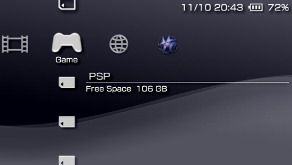

# PSP Battery Level

An ARK-4 plugin that shows **0%–100% beside the battery icon** in the XMB and the HOME menu opened during a game. It keeps the original clock and charging animation and adjusts the layout to the percentage's width.



## Compatibility

Tested on **PSP-2004, Sony 6.61, ARK-4 4.20.69 r206, with the standard theme**. Other configurations are not verified, and the plugin refuses unsupported models and ARK API versions. Do not bypass these checks.

The percentage appears in the XMB and GAME HOME only, not over gameplay. POPS is unsupported.

## Download

**[Download the latest release ZIP](https://github.com/scornface/psp-battery-level/releases/latest/download/psp-battery-level.zip)** · [All releases and source archives](https://github.com/scornface/psp-battery-level/releases)

The unified XMB/HOME build described here is not published yet. Build it from source using the instructions below; available downloads may support XMB only. Check the release notes for the package you download.

Release packages contain the ready-to-install `battery_level.prx`, this README and license notices. No development environment is needed to use a published package.

## Installation

1. Copy `battery_level.prx` to `ms0:/SEPLUGINS/`.
2. Check ARK's plugin manager and the applicable `PLUGINS.TXT` files. These may be in `ms0:/SEPLUGINS/` or the ARK installation/savedata directory, commonly `ms0:/PSP/SAVEDATA/ARK_01234/`. Replace existing battery-level entries rather than enabling a second copy. Preserve other plugins and enable this file for both contexts:

   ```text
   VSH, ms0:/SEPLUGINS/battery_level.prx, on
   GAME, ms0:/SEPLUGINS/battery_level.prx, on
   ```

3. Leave USB mode and fully reboot into ARK. For a live ARK installation, run ARK Loader again if needed. See [ARK's plugin instructions](https://github.com/PSP-Archive/ARK-4/wiki/Plugins) for configuration details.

Install only `battery_level.prx`; the build's ELF and user payload are not additional plugins. Do not enable it for POPS. No further runtime settings are required.

To disable or uninstall, disable/remove both entries and reboot. You can then delete the PRX. Do not unload the plugin from a running game.

## Troubleshooting

If the percentage does not appear, check the supported configuration, standard theme, PRX path and VSH/GAME entries. Look for duplicate entries in all applicable plugin files, then reboot.

For diagnostic logs, see [development](docs/development.md#diagnostics).

## Community feedback

Reports from other PSP-2000 variants and ARK-4 revisions are welcome, including successful operation. [Open an issue](https://github.com/scornface/psp-battery-level/issues) with your PSP model, Sony firmware, full ARK-4 version, theme and observed behavior.

Other configurations are not supported until verified. If the plugin refuses to load, report the configuration rather than bypassing its checks.

## Next steps

The goal is to show the battery percentage in the XMB and the HOME menus of GAME and POPS. XMB and GAME HOME are implemented; the next planned addition is POPS HOME support.

## Development

Building requires Docker, Python 3.10+, a POSIX shell and `shasum`. The build uses a pinned PSPDEV image and does not install anything on a console.

```sh
sh tools/build.sh
```

The installable file is `build/release/battery_level.prx`. For host tests, native SDK builds, formatting and hardware verification, see [development](docs/development.md).

- [Architecture](docs/architecture.md)
- [Native interfaces and firmware analysis](docs/analysis.md)
- [Dependencies](docs/dependencies.md)
- [Tool reference](tools/README.md)

## License

[MIT](LICENSE). Include the license and [third-party notices](THIRD_PARTY_NOTICES.md) when redistributing the plugin. No Sony firmware, fonts or resource files are included.
